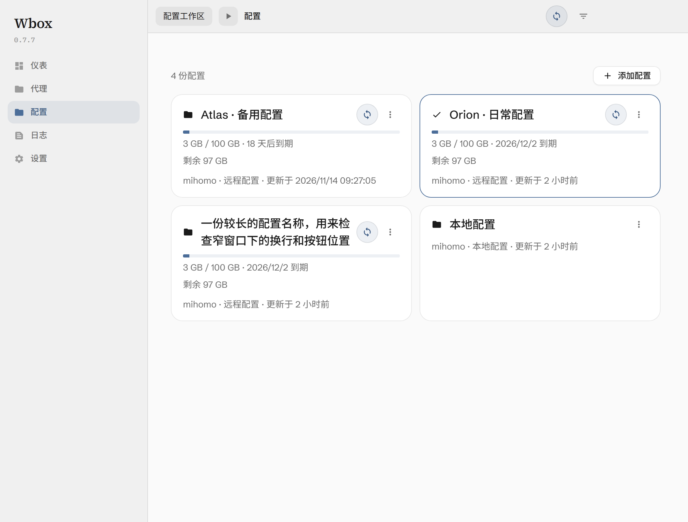
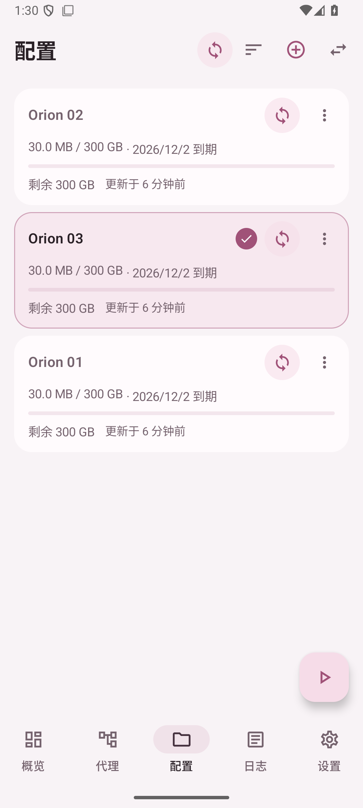
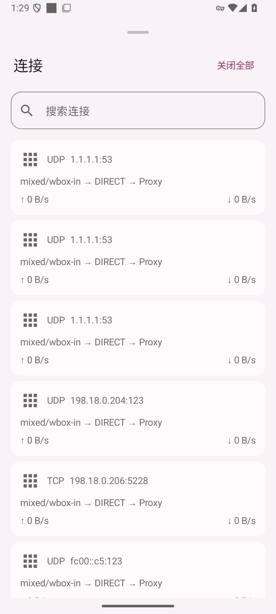
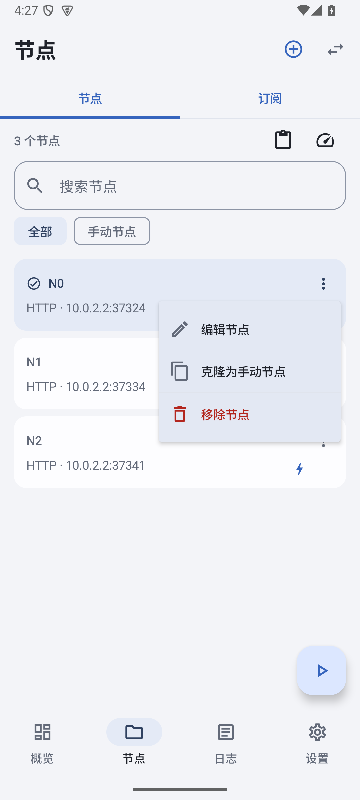

本项目完全由GPT-6 Astra生成

<div align="center">

# Wbox

**让连接更从容，让配置更清晰。**

Windows · Android ｜ mihomo · sing-box

[](https://github.com/muchaomuicho/Wbox/releases/latest)
[](LICENSE)
[](https://github.com/muchaomuicho/Wbox/releases/latest)
[](https://github.com/muchaomuicho/Wbox/releases/latest)

[官网](https://wbox.wucnebssss.hidns.co/) · [下载最新版本](https://github.com/muchaomuicho/Wbox/releases/latest) · [本次更新](docs/RELEASE-0.7.9.md) · [全部历史版本](https://github.com/muchaomuicho/Wbox/releases)

</div>

Wbox 是一款面向 Windows 与 Android 的双内核代理客户端。以中性底色配合柔和强调色，把完整配置与独立节点整理为两个工作区：需要细致分流时保留原配置，需要轻装连接时只运行所选节点。内核、规则与必要资源随包提供，日常使用不必反复准备环境。

## 界面一览

<div align="center">

<br/><sub>Windows：紧凑配置卡片支持拖动排序与直接右键，时间信息可独立切换显示。</sub>
<br/><br/>



<br/><sub>Android：配置长按排序，节点单击选定，三点菜单就近展开。</sub>
</div>

## 0.7.9：应用更新与资源占用

两端在「设置」中检查 GitHub 最新正式版；发现更新后先询问，确认才下载。下载显示进度、已下载大小与速率，界面可以收起，再从设置中查看进度。安装前校验文件大小与 SHA256；Android 另核对包名、版本和原签名。

Windows 在主进程下载，隐藏主窗口不影响下载；安装时安全停止内核，交由独立安装助手等待安装器结束并清理本次安装文件。Android 使用系统下载和安装服务，系统接收完整安装内容后清理下载副本，安装仍需按系统提示确认。

下载过程流式写盘，不把整个安装包读入内存。完整配置、双内核、内置规则与个人数据继续保留。

## 操作体验

两端节点菜单只保留编辑、克隆与移除，移除操作统一标红。批量测速开始后，本次参与测试的所有节点立即转圈，包括仍在排队的节点；收到结果后逐个显示新延迟，未参与测试的节点保持原样。节点工作区和配置工作区的代理组采用同样的反馈。

节点单击即可选定并保存：未连接时只选择，已连接时自动切换。Android 三点与长按打开按钮旁的悬浮菜单，支持系统返回。Windows 配置卡片支持直接右键和拖动排序；卡片保持紧凑留白与可读字号，代理页延迟数字与左下协议文字对齐。

Windows 圆润手形光标缩小到接近原生默认手形的可见尺寸，点击热点随图形同步调整。Android 连接、分应用代理等拉起面板去除内容边缘拉伸，快速滚回顶部后不再推动整个面板回弹，直接快拖标题或拉手也停在允许的边界内；保留正常惯性滚动和手指拖动关闭。

Android 长按整张配置卡片即可拖动，Windows 直接拖动卡片调整顺序，靠近列表边缘时自动滚动。Windows 点击与抓取光标使用清晰的矢量手形。手动顺序会保存，并同步到概览的配置选择；更新订阅、添加或删除配置时保留已有顺序。

双端流量信息旁默认显示具体日期和“到期”，点击可切换为剩余天数。更新时间默认显示“更新于 X 时间前”，点击可切换为具体日期时间；两种时间独立切换，点击不会选择配置或启动连接。

Android 连接、分应用代理等底部面板补齐随窗口挂载的系统返回回调和 Back 按键兼容入口，保留键盘优先收起及边角适配。

保留双端测速期间的节点与配置选择、独立订阅更新圆环、黑白／雾蓝／柔粉配色和配置编辑能力。

## 两个工作区，各自完整

- **配置工作区**：导入远程 URL 或本地 JSON / YAML，保留完整代理组、DNS 与路由；支持多份配置、代码编辑、更新订阅、导出、在线切换及代理组管理。
- **节点工作区**：独立管理订阅与节点链接，按来源筛选、搜索、编辑与克隆；只加载当前节点和显式依赖，继续使用内置 DNS、FakeIP、广告拦截及应用分流模板。

两工作区分别保存选择。节点工作区在两端都支持单击选定：未连接时不启动，已连接时自动切换。Windows 双击或 Enter 可显式连接，右键打开操作菜单，Ctrl+D 编辑，Ctrl+V 导入；Android 三点或长按打开悬浮菜单，也支持外接键盘快捷键。点击闪电仅测试延迟，使用独立临时内核，不启用系统代理、TUN 或 VPN，也不会改回测速开始时的选择。

## 下载与安装

在 [GitHub Releases](https://github.com/muchaomuicho/Wbox/releases/latest) 下载：

- `Wbox-0.7.9-windows-x64-setup.exe`：Windows 10 / 11 x64 安装程序，自带 Electron、.NET 运行库与双内核。
- `Wbox-0.7.9-android-arm64-v8a.apk`：Android 8.0+ ARM64 安装包，延续原签名，可覆盖同签名旧版。
- `Wbox-0.7.9-source.zip`：完整源码、上游来源、原生隧道、固定版本内核源码与构建脚本。
- `SHA256SUMS-0.7.9.txt`：发布文件 SHA256 校验值。

Windows 关闭窗口后保留托盘，左键恢复主界面，右键打开菜单；支持开机自启、静默启动与自动连接。托盘可切换运行策略组、配置、测速及关闭连接。Android 首次连接授权系统 VPN，支持全部应用、只代理所选应用或绕过所选应用，IPv6 默认开启。

## 功能与边界

固定集成 **mihomo 1.19.33** 与 **sing-box 1.14.4-wbox.1**，只启动当前所选内核。默认以 `clash.meta/1.19.33` UA 下载订阅，并根据内容识别内核。

支持 HTTP(S) 订阅、Base64 节点列表与原生 outbounds/proxies 提取；分享链接包括 SS／SS2022、VMess、VLESS／Reality、Trojan、Hysteria／Hysteria2、TUIC、AnyTLS、SOCKS、HTTP(S)、WireGuard，Windows 另支持 NaiveProxy。原生节点不做跨内核有损转换。暂不支持的 XHTTP、ECH 等分享参数会明确报错，可使用内核支持的完整配置。

订阅读取标准 `Subscription-Userinfo`，缺失字段标为“未提供”，下载失败保留上次数据。每个订阅可设置自动更新，间隔 15–10080 分钟；Android 后台任务由系统安排，断网或省电状态可能延后。

延迟测试默认使用 `https://www.apple.com/library/test/success.html`。两内核先建立连接，再测实际请求延迟；sing-box 使用 HTTPS，mihomo 支持 HTTP 与 HTTPS。代理组按实际节点去重，最多 4 并发；独立节点测速 Windows 最多 2 个临时内核，Android 1 个，单次内核请求超时 5 秒。

连接页提供活动逻辑流、来源应用、流量及连接详情；日志有级别颜色和自动跟随，概览显示 60 秒波形与应用／内核内存。连接数是内核报告的逻辑代理流，内存读数包含所标明的进程范围，不与只报告 Go 堆的数值直接比较。

Windows 在设置中选择系统代理；使用“TUN 模式”时，配置本身须包含 TUN 入站，并以管理员身份运行。停止时恢复持久备份的系统代理；其它软件已改动时不覆盖其设置。Android VPN 排除 Wbox 自身，运行副本将配置内 TUN 映射为受管 mixed 入站。完整配置引用的外部本地资源需要另行提供。

## 轻量设计

Windows 安装目录使用 LZX 透明压缩，主窗口隐藏后释放界面，托盘预加载以缩短首次打开等待。多个界面共享状态读取，合并连续通知，减少重复请求与节点数据复制；打包排除未使用的运行依赖。Android 使用 Kotlin、Compose 与 Material 3，长列表按可见区域创建，发布版启用 R8 和资源裁剪；数据库无损压缩，固定规则共享磁盘缓存。后台停止界面采样，不持有唤醒锁；低内存时清空图标缓存引用，不回收仍由界面使用的 Bitmap。内置 [26 份规则集与分流模板](docs/BUNDLED-RULES.md) 随版本固定，首次启动无需下载这些资源。

## 验证与历史归档

本轮检查应用更新的版本判断、安装包校验、下载进度、收起恢复、安装交接与清理，并验证共享状态读取。Android 使用隔离 API35 模拟器；发布 APK 另核对 ARM64 ABI、原签名、内核和离线资源。记录位于 [验证目录](docs/verification)，本轮以 `0.7.9-` 开头；此前菜单、批量测速、节点选择、排序、日期、系统返回及边界滚动检查仍保留。

Android 返回验证要求启用系统边缘手势监听，使用真实左右边缘滑动，并分别检查键盘优先收起与关闭面板；模拟器结果仍不能代替所有厂商手机的实际行为。

历史安装包与现存源码归档在 [各版本 Release](https://github.com/muchaomuicho/Wbox/releases)，文件核验见 [历史归档清单](docs/verification/history-archive.json)。**0.1.0 当时的源码包未留存**，该版本仅保存现存安装包和明确的缺失说明；其余历史源码以各版本随附的原始 source ZIP 为准。

尚未完成 Android 真机耗电、低内存与 16 KiB 页设备运行验证。JNI 和内核 ELF LOAD 已为 16 KiB 对齐；模拟器结果不代替这些实机验证。

## 从源码构建

需要 Node/pnpm、.NET SDK 8+、**Go 1.25.5+**、MinGW-w64 gcc、**JDK 21**、Android SDK 34/build-tools 34、NDK 28、Gradle wrapper 8.10 与 Inno Setup 6.7.3。前端依赖与上游来源见 [Windows](docs/UPSTREAM-DESKTOP.md) 和 [Android](docs/UPSTREAM-ANDROID.md) 构建说明。

```powershell
./tools/native/fetch-cores.ps1
./tools/native/build-tunnel.ps1 -NdkPath '<Android SDK>/ndk/28.0.13004108'
./tools/native/build-singbox.ps1 -Go '<Go>/bin/go.exe' -NdkPath '<Android SDK>/ndk/28.0.13004108'
./tools/build-desktop.ps1 -InnoCompiler '<Inno Setup>/ISCC.exe'
./tools/build-android.ps1 -JavaHome '<JDK 21>' -SdkPath '<Android SDK>' -Test
./tools/package-source.ps1
```

Android 签名密钥与密码位于本地 `signing/`，不包含在 GitHub 或源码包中。**请单独保留这个目录**：后续 APK 使用同一密钥才能覆盖已有安装。历史安装包归档不能替代签名密钥备份。

项目遵循 GPL-3.0；[第三方声明](THIRD-PARTY-NOTICES.md)、[Windows 实现](windows/README.md) 与 [原生隧道说明](native/README.md) 保留来源、许可证和构建细节。
