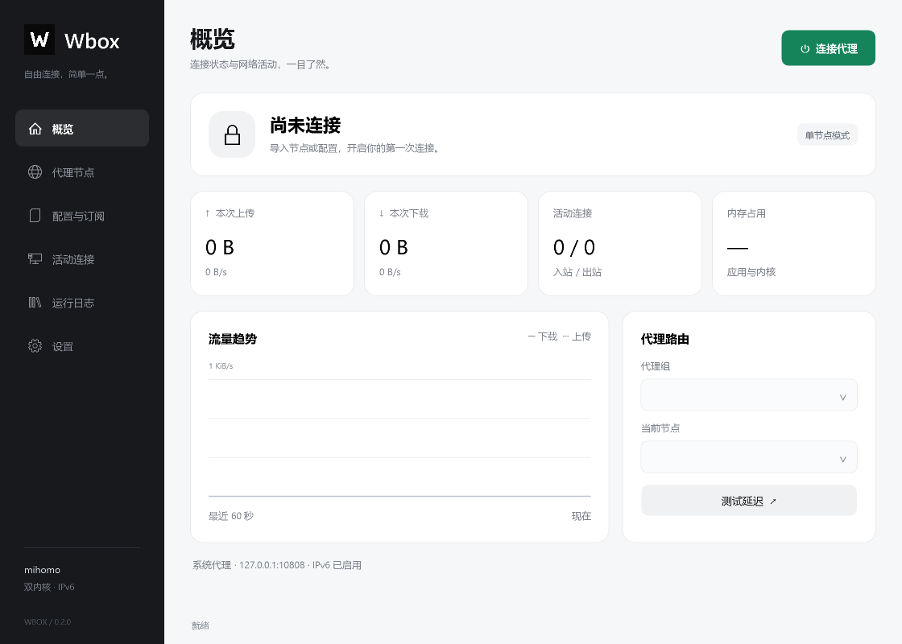
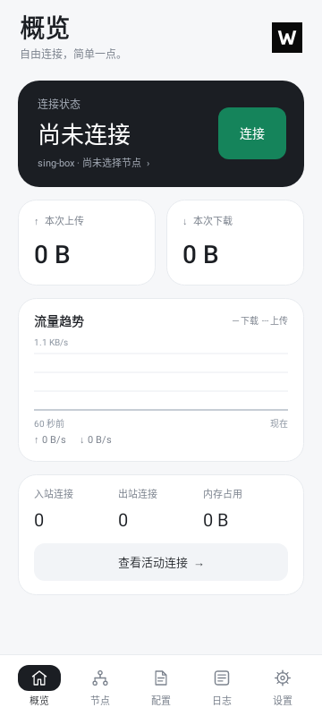

# Wbox 0.2.0

本次在现有双内核客户端上重做 Windows 与 Android 界面。Windows 使用深色侧栏、浅色内容区、独立的六个页面；Android 使用五项底部导航、连接卡片、流量卡片和可复用节点列表。两端以黑白灰为主，绿色用于连接操作，保留黑底白色 W 图标。

节点、完整配置和订阅仍通过原有内核运行。Windows 节点列表显示最近一次测速结果；Android 在切换页面后保留最近 60 秒流量历史，横轴使用实际采样时间。400 个节点的界面测试确认只创建可见列表项。Android 在前台每 5 秒读取内存，后台每 30 秒读取，前台/后台流量采样分别为 1 秒/10 秒；不新增唤醒锁或常驻动画。Windows 使用软件绘制减少 GPU 驱动资源，断开后每 5 秒更新可见窗口的内存数据。

## 安装文件

- `dist/Wbox-0.2.0-windows-x64-setup.exe`：Windows 10/11 x64，包含 .NET 运行库。
- `dist/Wbox-0.2.0-android-arm64-v8a.apk`：Android 8.0+ ARM64，使用原工作区发布密钥签名，可覆盖旧版。
- `dist/Wbox-0.2.0-source.zip`：客户端、原生隧道源码、固定内核源码压缩包与构建脚本；不包含签名私钥和用户配置。
- `dist/SHA256SUMS.txt`：发布文件 SHA256。

## 验证

Windows 原有 33 项核心与集成检查通过，包括两内核启动、六协议配置、节点切换、IPv6 转发和流量统计。六个页面已渲染检查，并检查了真实窗口的导航与内核下拉菜单。

Android 11 项配置/转发测试与 3 项 UI/历史测试通过，无跳过项。使用 Robolectric Native Graphics 渲染五个页面的 360/412 dp 布局，验证 400 节点列表复用和选择保存。Lint 无错误。APK 仅包含 arm64-v8a 内核。

当前没有连接 Android 真机，以上不代表真机 VPN 转发、耗电或峰值内存已验证。现有官方 sing-box Android 内核采用 4 KiB ELF 对齐，16 KiB 页设备兼容性仍未验证。Windows 使用系统代理；完整 TUN 配置及其权限要求见主 README。Windows 安装程序未做商业代码签名。

## 界面预览

以下为实际界面渲染，空闲状态不生成模拟流量。

## 参考

- [mihomo](https://github.com/MetaCubeX/mihomo)
- [sing-box](https://github.com/SagerNet/sing-box)
- [sing-box Android 概览页](https://github.com/SagerNet/sing-box-for-android/blob/dev/app/src/main/java/io/nekohasekai/sfa/compose/screen/dashboard/DashboardScreen.kt)
- [v2rayN](https://github.com/2dust/v2rayN)
