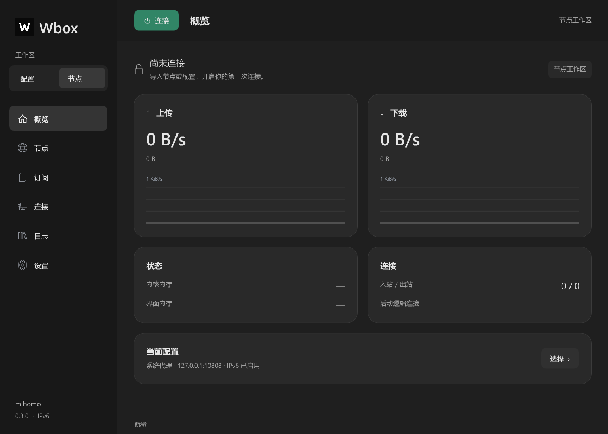
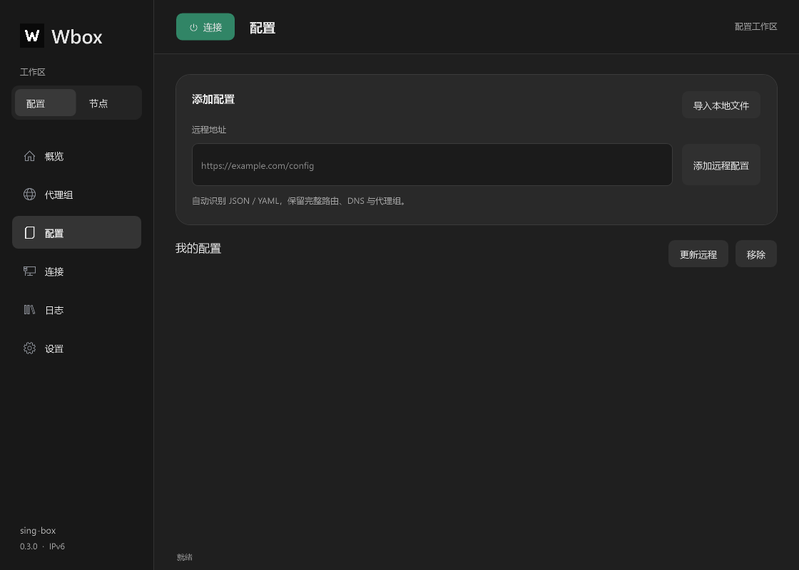
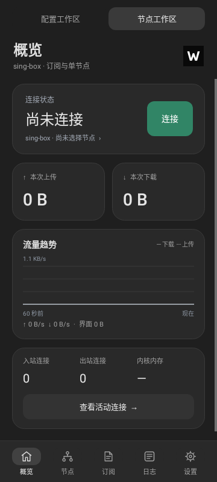
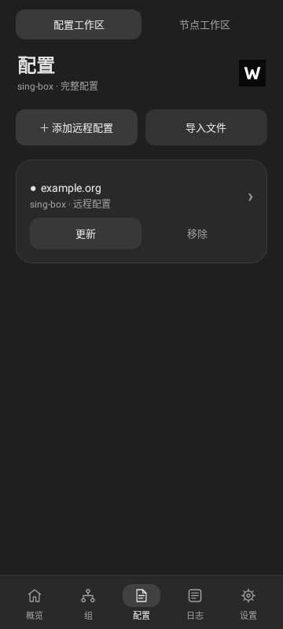

# Wbox 0.3.0

配置与节点现在是独立工作区。两端统一采用深灰底色、灰色卡片和白色文字，连接按钮使用绿色。移除了旧版深色侧栏与白色内容区的割裂配色。

## 使用方式

- **配置工作区**：添加 HTTP/HTTPS 远程配置或导入本地文件；按内容识别 sing-box JSON 与 mihomo YAML，无需 URL 带文件后缀。保存完整 DNS、路由和代理组，支持多份配置、更新和切换。
- **节点工作区**：导入订阅 URL、Base64 列表或分享链接；订阅与手动节点分别保存，支持来源筛选、搜索、选择和延迟测试。Windows 可离线临时启动内核测试，并可停止批量测速；Android 在连接后测试。

远程示例实际返回 sing-box 完整配置，包含 6 个代理组、2 个原生节点。完整导入与节点提取均通过内核配置检查；未连接示例中的远程节点。发布包不包含该示例的配置或凭据。

## 协议与限制

新增 AnyTLS、Hysteria、SOCKS、HTTP(S)、WireGuard，Windows 新增 NaiveProxy。保留 SS/SS2022、VMess、VLESS/Reality、Trojan、Hysteria2、TUIC，补齐 SS 插件、ALPN、Hysteria2 混淆、TUIC 参数与 TLS/SNI。原生 SSH 等节点保留原配置，使用对应内核。

官方 Android CLI 没有 NaiveProxy 构建能力，因此 Android 不将该节点标为可用。XHTTP、ECH 等未支持的分享参数需使用内核支持的完整配置；TLS SOCKS 使用 mihomo；WireGuard 的 dns 分享参数使用 mihomo 或完整 sing-box 配置。JSON/YAML 外部本地资源仍需另行放到可访问位置。

## 内存与后台

Windows 隐藏窗口时不更新图表、行数据和控件，统计间隔为 10 秒；完整连接行仅在连接页创建。Android 流式读取统计、跳过连接详情，详情按需加载，后台直接以 10 秒间隔调度；节点缓存与列表复用避免反复解析。日志有上限，两端仅运行所选内核。

Windows 本机单次托盘空闲实测：未连接界面 101.2 MiB；mihomo 界面 115.8 MiB / 内核 26.4 MiB；sing-box 界面 112.6 MiB / 内核 34.8 MiB。5 秒采样窗口内界面 CPU 时间增量为 0 ms（计时分辨率内）。使用隔离 DIRECT 配置，不能代表大订阅、真实代理连接或高流量峰值。方法见 `tools/measure-windows.ps1`。

内存分开显示界面与内核，避免把总 Working Set 与其他客户端的 Go 堆或内核读数混为一谈。Android 未做真机耗电、峰值内存与 VPN 转发测量。官方 Android sing-box ELF 仍为 4 KiB LOAD 对齐，16 KiB 页设备兼容性未验证。

## 发布与验证

版本号 0.3.0，Android versionCode 3，使用工作区原发布密钥，支持覆盖旧版。Windows 安装程序自带 .NET 8 运行库，未做商业代码签名。源码 ZIP 不含签名私钥、用户配置或临时测试内容。

Windows 47 项测试通过；Android 24 项测试通过，无跳过项；Android Lint 无错误。覆盖新增协议内核检查、IPv4/IPv6 HTTP 与 SOCKS5 UDP 回环转发、配置/节点工作区独立状态、失败更新保留旧数据、400 节点列表复用与 2000 连接流式统计。实际界面渲染已检查，APK 签名与 ARM64 架构已验证。

## 界面预览

以下是实际原生界面渲染；未连接时不生成模拟流量。

## 上游参考

- https://github.com/MetaCubeX/mihomo/tree/v1.19.33
- https://github.com/SagerNet/sing-box/tree/v1.14.4
- https://github.com/2dust/v2rayN

协议字段依据随项目保存的固定内核源码和 v2rayN 分享格式核对，界面布局参考用户给出的 sing-box / v2rayN 截图。
