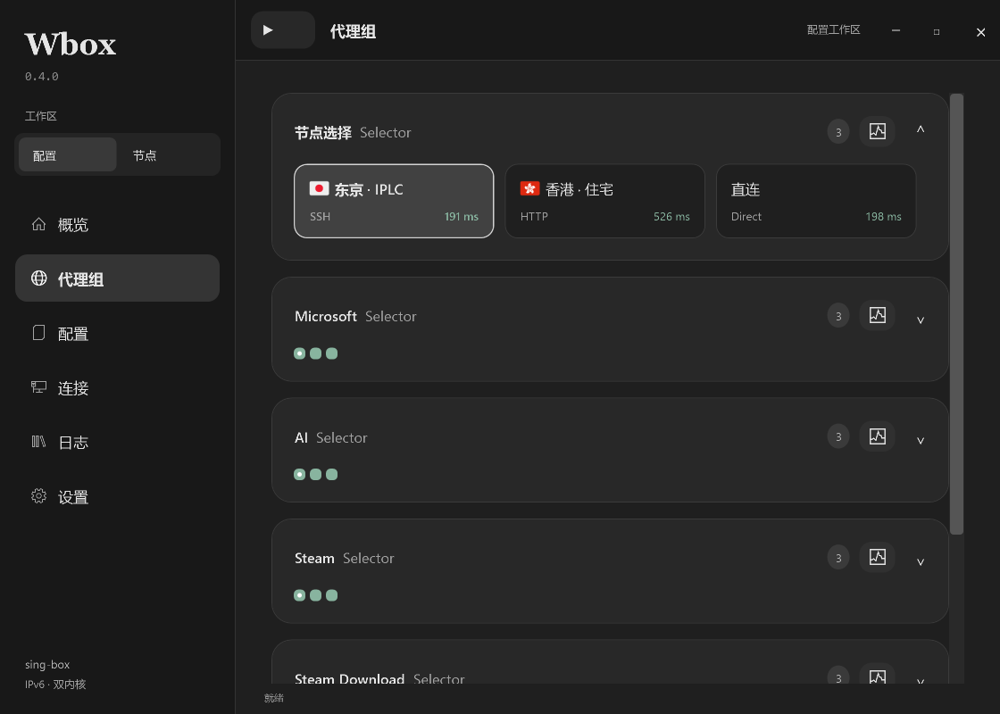
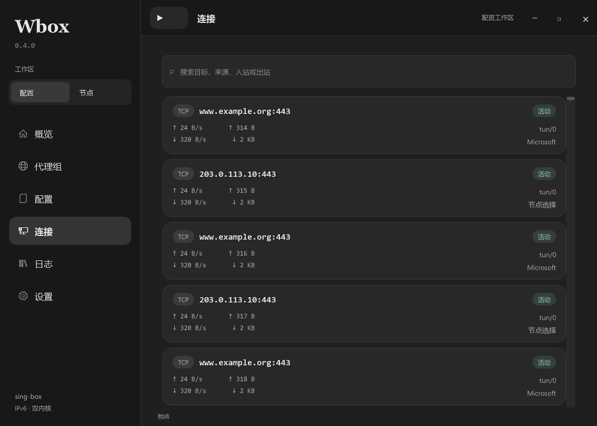
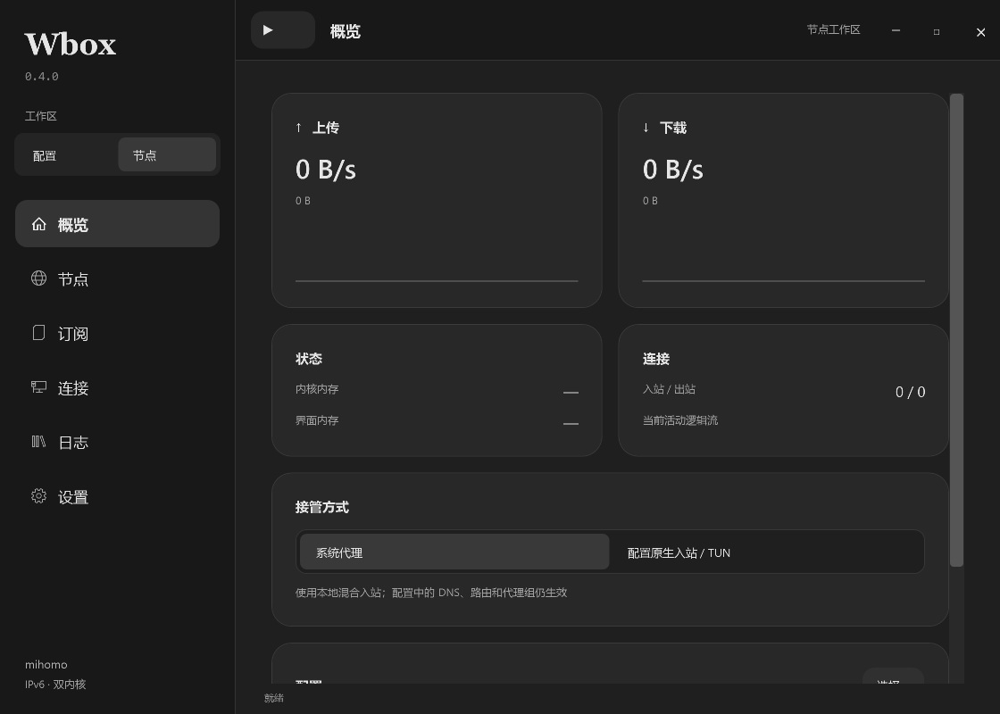
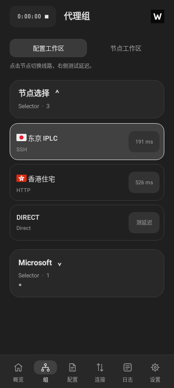
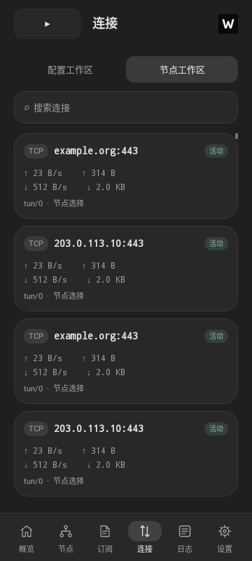

# Wbox 0.4.0

按照本轮提供的 sing-box 截图重写布局：深灰侧栏、顶部计时启停、圆角分组、可折叠代理组、带国旗与协议/延迟的节点卡片。连接页改为可搜索的活动卡片，显示目标、单连接速率、累计上传/下载与入出站信息。日志增加搜索和暂停；设置分为应用、内核和延迟测试。Windows 保留配置/节点两个工作区，Android 增加独立连接页。

## 启动修复

本机只读检查发现：用户选择的配置包含 `auto_route` TUN 和 `::7890` mixed 入站，Wbox 运行令牌没有管理员权限，7890 另有进程监听；10808/19090 当时未被占用。旧版把启动退出和控制接口超时都显示为“10808 或 19090 可能被占用”，没有准确说明失败阶段。旧版未落盘日志，因此不能还原截图当时首先触发的内核错误。

- Windows 概览新增接管方式。默认系统代理使用 Wbox 管理的本地 mixed 入站，保留首个原 mixed 入站的标签，以及配置的 DNS、路由和出站；不启动原配置的其他入站。原始配置文件不改写。
- 需要原生 TUN、HTTP/SOCKS 或其他入站时，选择“配置原生入站 / TUN”。原入站完整保留，Wbox 另提供受管 mixed 入站。TUN 会在启动前检查管理员权限；设置 → 内核与接管提供“以管理员身份重启”，由用户点击触发 Windows UAC。
- 10808 或 19090 被占用时，为 Wbox 管理的端口选择空闲端口，同步用于控制接口和系统代理。原生入站端口冲突会显示具体端口。
- 启动超时限定为 30 秒；失败显示内核退出码与最后的日志。启动阶段退出不会再触发运行阶段的异常退出处理，避免清理时竞争。

使用按入站标签匹配的规则时，要确保规则匹配实际使用的入站；系统代理模式复用第一条 mixed 的标签，没有 mixed 时为 `wbox-mixed`。需要原始入站语义的配置请选择原生模式。

## 国旗、资源与性能

258 个地区国旗内置于应用，无需联网。Windows 使用小尺寸位图代替系统字体中的区域字母；Android 使用受限位图缓存，节点/API 原始名称保持不变。图片来自 Twemoji v14.0.2，CC-BY-4.0，许可证与来源包含在安装包及源码中。

Windows 连接和节点列表复用可见行；折叠代理组不创建节点按钮，数据未变化时不重建组卡片。Android 流式读取连接记录，仅连接页保存明细，离开即释放；后台保留 10 秒采样，未添加唤醒锁。

同一 DIRECT 配置与测量脚本下，本机托盘抽样：未连接界面 101.8 MiB；mihomo 界面 116.7 / 内核 25.8 MiB；sing-box 界面 112.7 / 内核 34.9 MiB。各 5 秒窗口的界面 CPU 时间增量为 0 ms。与 0.3.0 的空闲内存基本相当，本轮优化主要针对大列表与后台明细分配，不能声称空闲内存大幅下降。脚本：`tools/measure-windows.ps1`。数字不是负载峰值或 Android 真机结果。

## 验证

Windows 53 项解析/配置/真实内核集成检查通过，包含 TUN 导入在受管模式启动、原入站保留、权限提示、双端口占用回退与正常停止不误报退出。WPF 实际渲染概览、配置、订阅、日志、设置，以及含国旗的代理组和 400 条连接；验证节点筛选后的索引映射和连接搜索、行复用。

Android 26 项测试通过，另 1 项需外部真实订阅文件的可选测试未执行。涵盖 400 条连接/节点行复用、搜索、离页释放、分组折叠、国旗图像、流式字段解析、2000 条连接计数，以及官方内核对 Android 生成配置的 HTTP/SOCKS5 UDP IPv4/IPv6 回环验证。Android 实际 JVM 渲染覆盖 360/412 宽度；不是手机 VPN 真机测试。

Android versionCode 4，versionName 0.4.0，继续使用原发布证书，可覆盖旧版。Windows 自带 .NET 8，未做商业代码签名。APK 为 ARM64；Android 真机耗电、VPN 稳定性和 16 KiB 页设备仍未验证，官方 sing-box Android ELF 仍为 4 KiB LOAD 对齐。协议范围及 NaiveProxy 等已有平台限制见 README。

## 界面预览

以下是应用实际渲染。代理组、节点名、延迟与连接数据均为合成测试夹具，不是用户订阅或真实流量。

